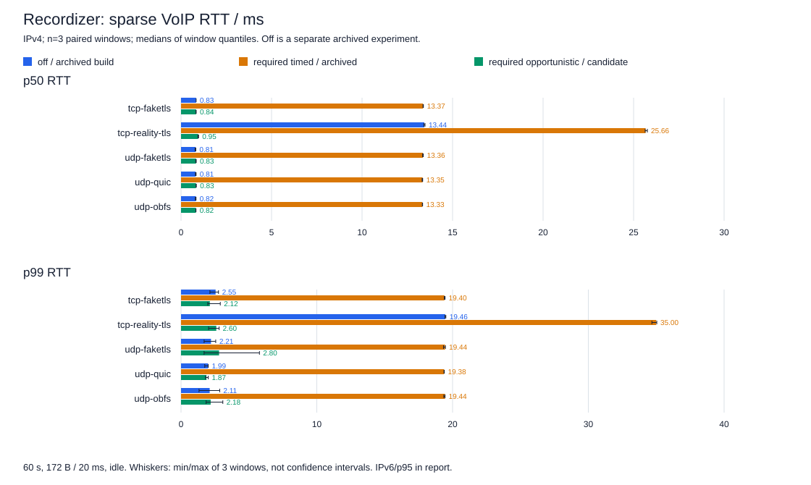
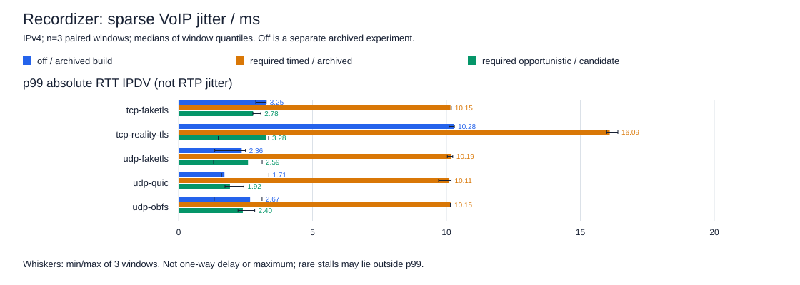
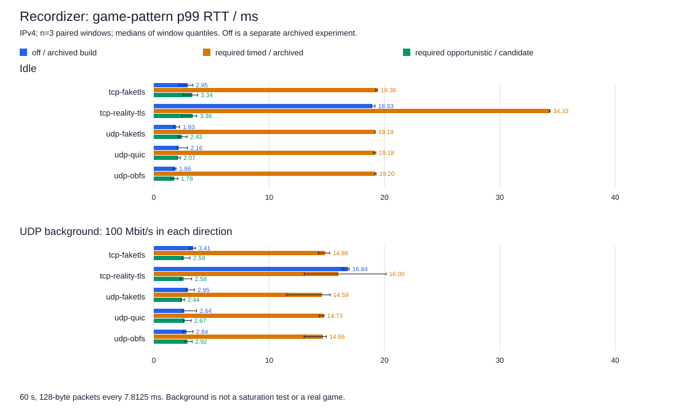
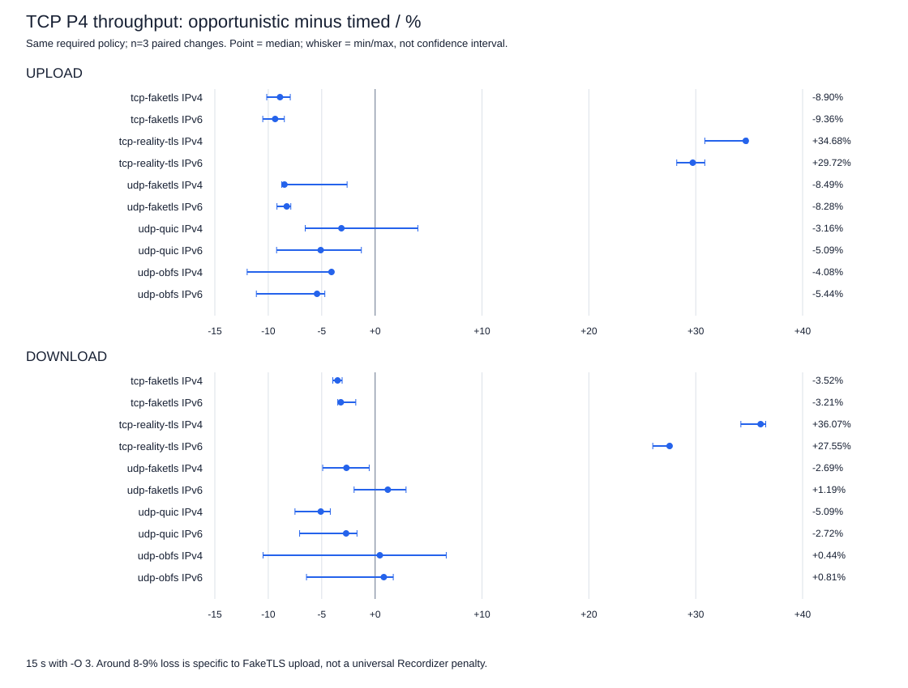

# Recordizer: задержки, jitter и цена низколатентного режима

Отчёт от 29 октября 2026 по экспериментам 26–29 октября. Это инженерные
Linux A/B, **не аттестация итогового `release/dist` и не опубликованный релиз**.
Проверенные бинарники назывались 0.8.3; текущие исходники dev уже имеют версию 0.8.4.

## Вывод

Прежний `timed` добавлял около **12–13 мс RTT** на редком трафике. У Reality-TLS
с отдельным H2 накоплением суммарный p50 достигал **25,7–25,9 мс**. В кандидате
`opportunistic` p50 составил **0,82–0,95 мс**, p99 **1,87–3,00 мс**: практически
убрана **искусственная задержка накопления**, а не сетевая задержка вообще.

Цена в измеренных FakeTLS TCP P4 upload — **около 8–9% максимальной скорости**:
TCP-FakeTLS −8,90%/−9,36%, UDP-FakeTLS −8,49%/−8,28% для IPv4/IPv6.
Это **не общий штраф каждого профиля**: Reality-TLS, напротив, ускорился.
Старый режим сохранён, дефолт `timed` не изменён. Первичный кандидат не прошёл
предложенный допуск потери скорости 5% в ряде ячеек; успешная задержка не делает
весь A/B безусловно успешным. Отдельные ACK-эксперименты не дали нужного выигрыша
и исключены из рабочего кода.

## Какие проверки проведены

| Серия | Изменяемый фактор | Нагрузка и повторяемость |
| --- | --- | --- |
| 20 октября, [архивный throughput](recordizer_required_off_2026-10-20.md) | `required/off`, один бинарник 0.8.2, 12 профилей | n=1 скоростной прогон; не измерение интерактивного jitter |
| 26 октября, off/required | Только policy старой сборки; H2 у Reality сохранялся в обоих режимах | 5 профилей × IPv4/IPv6 × VoIP/game × idle/фон; n=3 парных окна |
| 27 октября, timed/opportunistic | Архивный `timed` против кандидата `opportunistic`, оба required; дополнительный timed-контроль кандидата | Та же матрица задержек; TCP P4 и UDP600 n=3; P1/UDP1000 n=1 диагностически |
| 29 октября, локализация | Сопоставление raw, исходников, ожиданий и частоты отправок | Установлены более мелкие ACK batches и синхронный usage fsync; это разные механизмы |
| 29 октября, раздельные исправления | Два ACK-варианта и отдельно usage offload, required | ACK n=3 отклонены; usage A/B и независимые подтверждения, включая длинные окна |

Профили: `tcp-faketls`, `tcp-reality-tls`, `udp-faketls`, `udp-quic`, `udp-obfs`.
VoIP — 172 байта каждые 20 мс; game — 128 байт каждые 7,8125 мс; окно 60 с.
Фон `bidir100` — **UDP 100 Мбит/с в каждом направлении**, не насыщение TCP.
Дополнительно: sparse 96 байт/100 мс/30 с и ограниченная проверка 250 pps/10 с.
Прямые 1000/5000 pps проверки обнаруживали ограничения таймера IRTT, а не потолок VPN.
TCP P4/UDP600 — 15 с, `-O 3`; UDP1000 — предложенная нагрузка, не найденный ceiling.

Стенд: VM300 сервер, VM301 клиент; **по 2 vCPU / 2048 МиБ**, Linux kernel 6.12.111,
хост i5-8500, локальный изолированный LAN. TUN MTU 1400, TX queue 1000 с обеих сторон,
два серверных TUN queue; конфиги и ресурсы между плечами не тюнились.
На 302 выполнялась только сборка. Исходные бинарники/raw сохранены; 300/301 восстановлены.
В этой документирующей проверке нагрузка на 300/301 заново не запускалась.

## Бинарники и воспроизводимость

| Роль | SHA256 |
| --- | --- |
| Архивный 0.8.3: off/required и timed A | `9cc1dfb84ccdee3bc0fb23aa3b0745882b0d520a325134112be2575512b62a1d` |
| Низколатентный кандидат B; timed-контроль C того же кандидата | `df933b86f6efc0613c9c20d11a35fef5a4a31ca6b2f13c198e774a7b9fd2c1aa` |
| Отдельный usage-only кандидат последующей проверки | `41b724726116aac49308ab971be8ef7f9ebeac0c8f9585daf13f0fa7fafe23b4` |

[Компактные данные](../../../data/benchmarks/recordizer_latency_2026-10-29.json)
содержат полные SHA входных сводок, все основные условия IPv4/IPv6, парные изменения,
потери, retransmits/TUN drops скоростных окон, исходные review и восстановление.
Большие raw остаются на гостях в отдельных каталогах:

```text
/opt/qeli-release-short-083-latency-ab-20261026-resume1
/opt/qeli-release-short-083-lowlat-ab-20261027
/opt/qeli-release-short-083-lowlat-localization-20261029
/opt/qeli-release-short-083-ack-usage-20261029-a3-main
/opt/qeli-release-short-083-ack-usage-20261029-quic-confirm
/opt/qeli-release-short-083-ack-usage-20261029-tail-confirm
```

Графики воспроизводятся без доступа к стенду:
`python scripts/render_recordizer_latency.py`; проверка: тот же вызов с `--check`.
[Генератор SVG](../../../../scripts/render_recordizer_latency.py) использует только
компактные данные. На графиках задержки явно выбран IPv4; IPv6 не скрыт, он дан ниже
и в JSON. `off` взят из отдельной серии, а не выдан за третье плечо того же A/B.

## Задержка и jitter

Числа — медианы квантилей трёх окон, не квантили объединённых пакетов.
RTT — туда и обратно; односторонняя задержка не измерялась, делить RTT пополам нельзя.
Jitter здесь — **p99 абсолютного изменения RTT между соседними пакетами (IPDV)**,
не средний jitter и не RTP interarrival jitter. p99 не является максимумом.





VoIP idle, значения IPv4 / IPv6, мс:

| Профиль | Off p50 | Timed required p50 | Opportunistic required p50 | Новый p95 | Новый p99 | Jitter p99: timed → новый |
| --- | ---: | ---: | ---: | ---: | ---: | ---: |
| TCP-FakeTLS | 0,83 / 0,82 | 13,37 / 13,37 | 0,84 / 0,85 | 1,00 / 1,00 | 2,12 / 1,89 | 10,15 / 9,97 → 2,78 / 1,70 |
| Reality-TLS/H2 | 13,44 / 13,47 | 25,66 / 25,85 | 0,95 / 0,95 | 1,10 / 1,12 | 2,60 / 3,00 | 16,09 / 15,92 → 3,28 / 3,03 |
| UDP-FakeTLS | 0,81 / 0,84 | 13,36 / 13,32 | 0,83 / 0,84 | 0,96 / 0,96 | 2,80 / 2,53 | 10,19 / 9,96 → 2,59 / 3,17 |
| UDP-QUIC | 0,81 / 0,83 | 13,35 / 13,35 | 0,83 / 0,84 | 0,97 / 0,97 | 1,87 / 1,89 | 10,11 / 10,03 → 1,92 / 1,53 |
| UDP-OBFS | 0,82 / 0,83 | 13,33 / 13,38 | 0,82 / 0,84 | 0,96 / 0,98 | 2,18 / 2,19 | 10,15 / 10,04 → 2,40 / 2,72 |

Timed-колонки здесь из A/B 27 октября; off — из 26 октября. В исходном off/required
A/B timed p50 был 13,3–13,4 мс и 25,7–25,9 мс у Reality-TLS; различия между сериями
не подменяются точными парными дельтами.



При game + фоне новый p99 составил **2,44–3,60 мс** по всем пяти профилям и обоим
семействам, против **14,07–18,86 мс** у timed; в этих окнах потерь IRTT не было.
Это не настоящая игра, не голосовой кодек и не проверка мобильной сети.

## Скорость: что стоит выигрыш задержки



Точка — медиана **парных процентов**, отрезок — минимум/максимум трёх пар, не доверительный
интервал. Это не отношение отдельно рассчитанных медиан Mbps.

| Профиль | IPv4 upload | IPv4 download | IPv6 upload | IPv6 download |
| --- | ---: | ---: | ---: | ---: |
| TCP-FakeTLS | −8,90% | −3,52% | −9,36% | −3,21% |
| Reality-TLS/H2 | +34,68% | +36,07% | +29,72% | +27,55% |
| UDP-FakeTLS | −8,49% | −2,69% | −8,28% | +1,19% |
| UDP-QUIC | −3,16% | −5,09% | −5,09% | −2,72% |
| UDP-OBFS | −4,08% | +0,44% | −5,44% | +0,81% |

Прямой baseline до/после A/B: upload −1,56%, download +1,76%. Колебания отдельных
UDP-OBFS окон и ячейки около/ниже −5% сохранены в review. Вывод «задержка почти
убрана ценой около 8% скорости» полезен **для измеренного FakeTLS upload**, но
нельзя переносить его на каждый профиль, направление, UDP600 или другое устройство.

## Первичные проблемы и последующая диагностика

1. В первом lowlat UDP-FakeTLS IPv4 VoIP-окне отмечено **47/3000 = 1,57%** потерь.
   Raw сохранён. Локализация установила `ShortInterval` rejects отражателя IRTT 0.9.0
   с `-i 50us` после реальной паузы. Это не доказанные потери пакетов Qeli. В последующих
   A/B одинаково использован `irtt server -i 0`; реальная пауза при этом не объявлена выдуманной.
2. Синхронный usage `fsync` исполнялся в Tokio. В отдельном usage-only A/B 12/12
   вызовов baseline прошли на `tokio-rt-worker`, 12/12 новых — на `qeli-usage-save`.
   Долговечность сохранения не отключалась. Исходная пауза до 583 мс повторно не
   воспроизведена: устранён подтверждённый механизм, но не доказано исчезновение всех хвостов.
3. Первичный рост p99 usage-only **+1,13 мс** не скрыт. В независимых n=3 парах по
   60 с медиана парной дельты была **+0,73 мс**; во всех шести 10-секундных сегментах
   медианная дельта оставалась ниже +1 мс. Это не обещание нулевого влияния usage.
4. У двух zero-wait ACK-вариантов не найден устойчивый нужный выигрыш upload; они
   отклонены и убраны. Предложенное ACK-only окно около 1 мс **не реализовано этим отчётом**.

## Готовность исходников и границы проверки

29 октября на **302**, в отдельном снимке текущего dev, проверены: чтение/сохранение
INI, default/validation/JSON, серверный AUTH push и разбор клиентом; отсутствие timer
deadline у opportunistic, одиночный пакет, хвост фрагментации и legacy timed;
H2 без продвижения тестовых часов, flow control и stalled-stream deadlines.
Проверены клиентские/серверные TCP/UDP места завершения готовой пачки и повторные
подключения/дополнительные TCP streams; transport-core вызывает те же client pumps.
Добавлен переключатель панели с RU/EN текстом, сохранением delay-полей и default `timed`.
Результаты команд и SHA снимка находятся в `source_check` общего JSON.

Итог на 302: фильтр Recordizer — 22 passed; H2 — 5 passed; AUTH и INI roundtrip —
по одному passed; web — 181 passed / 5 ignored. Standalone client и FFI `cargo check`
прошли. Локально JS редакторов — 125 passed, включая сохранение режима/delay при
нормализации и rollback; генератор INI подтвердил покрытие нового ключа. Часть тестов
попадает в несколько фильтров, их нельзя складывать как число уникальных проверок.

Это целевые Linux unit/check, **не полный аудит безопасности, не все платформенные
сборки, не тест iOS/Android/Windows на устройствах и не квалификация итогового ELF**.
Оба ядра должны поддерживать поле; старый `PACKET_MUX_V1` клиент может его проигнорировать.
Проверять только наличие capability недостаточно. После сборки финального кандидата
нужен отдельный короткий релизный тест именно его SHA.

## Как применять вывод

Для интерактивного трафика новый режим предпочтительнее по измеренным задержкам;
для максимальной скорости и прежней временной маскировки остаётся `timed`.
**Нельзя обещать прежнюю DPI-устойчивость:** снятие ожидания меняет временной рисунок.
Криптография, QRM1, лимиты, reassembly и H2 flow control не отключаются.
Сетевой RTT, очереди, CPU, bandwidth/stealth pacing по-прежнему могут задерживать пакеты.

Для игр лишние 12–25 мс RTT — заметная инженерная цена; для обычного разговора это
не автоматически плохое качество. Качество реального VoIP с jitter-buffer, WAN loss,
мобильным RTT и насыщением линии этим LAN-тестом не установлено.
См. [режимы и настройку](../../reference/RECORDIZER.md),
[обфускацию](../../manuals/OBFUSCATION.md) и [эксплуатацию](../../manuals/OPERATIONS.md#recordizer-batch-mode).

## Дополнение: временная маскировка

После этого A/B проведён отдельный [пилот временного рисунка Reality-TLS](recordizer_masking_pilot_2026-10-29.md)
с тем же lowlat SHA, required и H2-контролем. Он количественно разделяет уменьшение
размытия ритма и распознавание VPN; содержит графики, все варианты классификации
и ограничения корпуса. Его собственные echo/offload-условия не подменяют IRTT
и скоростные числа выше. Потеря 8–9% скорости не означает потерю 8–9% скрытности.
