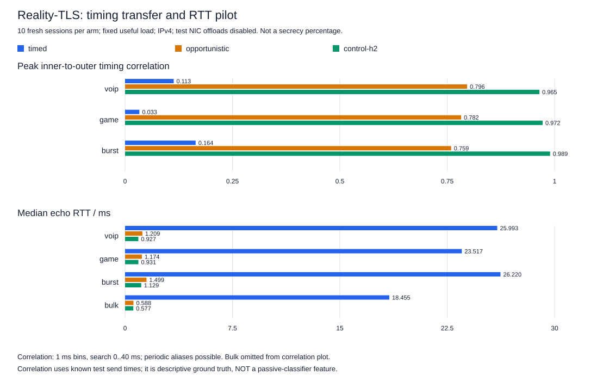
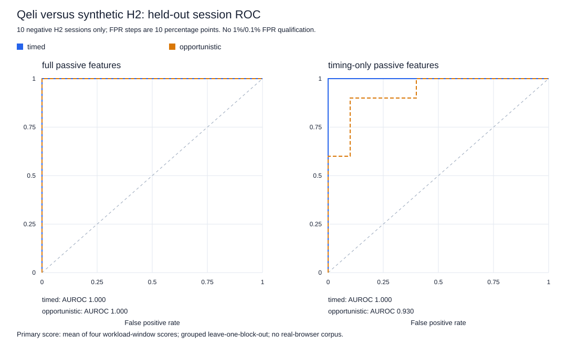

# Recordizer: пилот временного рисунка и распознаваемости Reality-TLS

29 октября 2026. Продолжение [A/B задержек и скорости](recordizer_latency_2026-10-29.md).
Это **ограниченный IPv4 LAN-пилот**, не вероятность обнаружения промышленным DPI,
не проверка браузерной эквивалентности и не аттестация итогового `release/dist`.

## Главный вывод

`opportunistic` гораздо точнее передаёт наружу ритм приложения: потеря временного
размытия измерима. Однако это **не означает автоматически более лёгкое распознавание
VPN**: синтетическое интерактивное H2-приложение контроля тоже передаёт этот ритм. По полному набору
признаков оба режима отделялись от нашего синтетического контроля (AUROC 1,00);
по одним таймингам новый режим оказался менее отличимым (1,00 → 0,93).

Нельзя перевести эти результаты в «потеряли X% скрытности». В частности, измеренные
ранее **8–9% потери максимального FakeTLS upload** — другой эксперимент и другая
метрика, не цена маскировки. Преимущество `timed` в размытии ритма подтверждено;
универсальное преимущество против DPI не установлено. Default не изменялся.

## Стенд, бинарник и изменяемый фактор

- VM300/server и VM301/client: по **2 vCPU / 2048 МиБ**, kernel 6.12.111.
- Один экспериментальный `qeli 0.8.3` на обеих сторонах, без пересборки:
  SHA256 `df933b86f6efc0613c9c20d11a35fef5a4a31ca6b2f13c198e774a7b9fd2c1aa`.
- Только `tcp-reality-tls`, **Recordizer required**. Между Qeli-плечами менялся
  только `obf.recordizer.batch.mode`: `timed` / `opportunistic`.
- TUN MTU 1400, TX queue 1000 с обеих сторон, два серверных TUN queue;
  padding false, traffic shaping true, stealth false. Очереди/RAM/vCPU не тюнились.
- Третье плечо — собственное синтетическое приложение: **TLS 1.3 / настоящий H2,
  streaming POST/echo**, ALPN `h2`, ответ 200 и тот же ритм полезных сообщений.
  Это не браузер, не видеосервис и не репрезентативный Internet-корпус.
- 302 и Proxmox в этом пилоте не использовались. H2-инструменты размещены в
  приватном префиксе теста; системные пакеты не устанавливались/обновлялись.

## Методика

10 временных блоков, в каждом — новая сессия каждого из трёх плеч. Порядок плеч
циклически менялся и разворачивался. Одна сессия несла четыре окна по 8 секунд:

| Сценарий | Полезное сообщение | Расписание | Предложенная полезная нагрузка в одну сторону |
| --- | ---: | --- | ---: |
| Голосовой ритм (`voip`) | 172 байта | каждые 20 мс | 0,0688 Мбит/с |
| Игровой ритм (`game`) | 128 байт | каждые 7,8125 мс | 0,131072 Мбит/с |
| Всплески (`burst`) | 128 байт | 8 сообщений каждые 100 мс | 0,08192 Мбит/с |
| Непрерывный (`bulk`) | 1200 байт | каждую 1 мс | 9,6 Мбит/с |

Ответы echo дают обратное направление. Это одинаковая предложенная нагрузка,
**не** поиск предельной скорости. Итого 30 основных сессий / 120 окон, плюс
3 проверочных сессии / 15 окон; проверочный блок исключён из классификации.

Захват на `eth1` клиента, kernel BPF ограничен тестовой парой и TCP 443/8443.
Сохранялись только `t_ns`, направление, IP/TCP длины, flags, seq, ack; пакетные
байты, TLS secrets и содержимое приложений не сохранялись. Полные сессии handshake
и active probing не исследовались. IP/порты/сертификат/имена файлов/метки плеч не
использовались как признаки.

GRO/GSO/TSO/rx-gro-hw на тестовых `eth1` симметрично выключены для захвата, затем
восстановлены. Все IP-пакеты в основной выборке не больше 1500 байт. Это отдельные
**инструментированные условия**: выключение offload само меняет packetization/CPU,
поэтому абсолютные числа нельзя напрямую объединять с прежним IRTT или production.

## Насколько наружу передаётся ритм

Для каждой сессии считалась корреляция временных рядов известных отправок тестового
генератора и внешних payload-пакетов client→server: bins 1 мс, максимум по сдвигам
0..40 мс. Ниже медиана 10 сессионных максимумов. Это описательная метрика с известной
внутренней нагрузкой, **не** признак, доступный одиночному пассивному DPI. Возможны
алиасы периодичности; найденный сдвиг не является односторонней сетевой задержкой.
Времена отправок записывались после передачи сообщения в API отправки.

| Сценарий | Timed | Opportunistic | H2-контроль |
| --- | ---: | ---: | ---: |
| Голосовой | 0,113 | **0,796** | 0,965 |
| Игровой | 0,033 | **0,782** | 0,972 |
| Всплески | 0,164 | **0,759** | 0,989 |

Высокий коэффициент показывает меньшее размытие исходного ритма, а не «X% потери
защиты». Даже низкая корреляция этой метрики не исключает распознавание приложения
другими признаками, например спектральными. Bulk не показан на графике корреляции:
почти постоянный входной ряд делает интерпретацию особенно зависимой от генератора.



## Проверка распознаваемости

Семь пассивных признаков: средняя длина TCP payload и её CV; медиана промежутков
между payload-пакетами одного направления и их CV; доля промежутков менее 1 мс;
доля смен направления; максимальный промежуток. Отдельно оставлены только пять
временных признаков. Окна не объединялись в «миллионы независимых примеров».

Модель — заранее заданная L2 logistic regression: log1p, стандартизация **только
на обучающей выборке**, баланс классов, lambda 0,1, 1000 шагов с learning rate 0,2,
без подбора гиперпараметров. Leave-one-block-out исключает целый блок вместе со
всеми его соединениями и окнами. Основной score сессии — среднее четырёх окон;
заранее заданная проверка чувствительности — максимум по окнам.

Уточнение исходного плана сделано до извлечения признаков: отношение внешних пакетов
к полезным сообщениям оставлено описательной метрикой, но **исключено из модели**,
так как требует знания внутренних отправок. Спецификация и её SHA сохранены в данных.

| Задача / признаки | Timed AUROC | Opportunistic AUROC |
| --- | ---: | ---: |
| Qeli против H2-контроля: размеры + тайминги | **1,00** | **1,00** |
| Qeli против H2-контроля: только тайминги | 1,00 | 0,93 |

Отдельная задача различения **двух режимов Qeli** дала AUROC 1,00 как с полным
набором, так и по таймингам. Это доказывает изменение отпечатка, не обнаружение VPN.



Полная картина фиксированного порога 0,5, число сессий с меткой «Qeli»:

| Признаки / объединение окон | Timed | Opportunistic | H2-контроль (ложные срабатывания) |
| --- | ---: | ---: | ---: |
| Размеры + тайминги / среднее | 10/10 | **0/10** | 0/10 |
| Размеры + тайминги / максимум | 10/10 | **10/10** | 0/10 |
| Только тайминги / среднее | 10/10 | 0/10 | 0/10 |
| Только тайминги / максимум | 10/10 | 10/10 | **10/10** |

**0/10 при одном пороге не означает невидимость.** Полные scores нового режима
оставались выше всех контрольных, что и даёт AUROC 1,00; при другом пороге их можно
разделить в наблюдаемом корпусе. Это не независимо проверенный рабочий порог DPI.
Вариант «максимум / только тайминги» помечал вообще всё и потому непригоден как
детектор здесь. Эти неудобные результаты не исключены из отчёта.

Контрольных сессий всего 10: шаг эмпирического FPR — 10 процентных пунктов.
Контроль использует Python/OpenSSL и библиотеку h2, Qeli — другой стек. Часть
различимости может характеризовать конкретную реализацию контроля, а не уникальный
признак VPN или Recordizer. Один контрольный сервис не покрывает разнообразие
обычного HTTPS/H2, в том числе произвольные прикладные размеры и схемы обмена.

Даже для 0/10 обычная оценка Wilson даёт верхнюю границу около 27,8% (95%);
это не валидация FPR 1% или 0,1%. Такие интервалы также не учитывают смену домена
трафика и неопределённость обучения. Scores не являются вероятностями обнаружения
реальным цензором. Полный набор упёрся в потолок различимости этого малого корпуса.

## Задержки и качество измерения

Это собственный UDP/H2 echo-генератор, **не прежний IRTT**. Значения — медианы
сессионных p50/p99, не квантили объединённых пакетов:

| Сценарий | Timed p50 / p99, мс | Opportunistic p50 / p99, мс | H2 p50 / p99, мс |
| --- | ---: | ---: | ---: |
| Голосовой | 25,99 / 35,08 | 1,21 / 1,62 | 0,93 / 1,11 |
| Игровой | 23,52 / 34,44 | 1,17 / 1,44 | 0,93 / 1,08 |
| Всплески | 26,22 / 35,51 | 1,50 / 2,75 | 1,13 / 1,46 |
| Непрерывный | 18,46 / 29,20 | 0,59 / 1,55 | 0,58 / 0,78 |

301 920 основных полезных сообщений получили echo-ответы; capture socket drops —
0 во всех 132 захватах. Ответ ожидался до 0,75 с после окна: это счётчик echo,
не отдельное доказательство отсутствия сетевых retransmits. Тайминги генератора
не идеальны; фактические отправки и lateness сохранены. Медианные p99 lateness
VoIP: 2,17 / 2,24 / 2,23 мс; game: 1,23 / 1,24 / 1,25 мс для timed/opportunistic/H2.
У burst они различались сильнее (2,29 / 1,38 / 1,79 мс), что ограничивает интерпретацию.

Захват стоил около 1–3,5% одного ядра на редком трафике. На bulk медианы были
8,17% / 25,08% / 15,36%, максимум 26,25% одного ядра. Только для VoIP был один
последовательный preflight с захватом/без него; для bulk такой пары нет. Нулевое
влияние наблюдателя не доказано. В бинарнике также остаётся прежний синхронный usage
путь; редкие паузы VM/I/O нельзя целиком приписывать batching.

## Восстановление и артефакты

300/301 восстановлены: 17 базовых проверок на каждой ВМ, исходный usage-файл и SHA.
Дополнительная **полная** сверка offload обнаружила, что возврат родительского TSO
включил `tx-tcp-mangleid-segmentation`, изначально выключенный. Этот единственный
производный флаг отдельно возвращён в `off` на обеих ВМ; полная карта затем совпала.
Первичный result не переписан, follow-up сохранён. Тестовые процессы остановлены,
блокировки сняты; прежние бинарники/raw не изменены. Релиз не публиковался.

Raw остаётся в закрытом `/opt/qeli-release-short-mask-pilot-20261029` на гостях.
Каталог включает приватные тестовые конфиги и ключ собственного TLS-контроля:
**не публикуйте его целиком**. В репозитории только
[обезличенные данные и признаки](../../../data/benchmarks/recordizer_masking_pilot_2026-10-29.json),
графики и offline-скрипты. Воспроизведение без ВМ:

```sh
python scripts/analyze_recordizer_masking_pilot.py --check
python scripts/render_recordizer_masking_pilot.py --check
```

[Пересчёт моделей](../../../../scripts/analyze_recordizer_masking_pilot.py) и
[генератор графиков](../../../../scripts/render_recordizer_masking_pilot.py) используют
только компактные признаки; первичное извлечение из заголовочных метаданных этим
не повторяется. Хэши исходных входов и алгоритмов сохранены в JSON.

## Практическое решение

Новый режим хуже размывает **ритм приложения**, но пилот не установил процент
ухудшения **распознаваемости VPN**. Старый случайный таймер тоже формирует свой
отпечаток. Сохранены оба режима и default `timed`; изменение default или обещание
прежней DPI-устойчивости требуют отдельного решения и более широкого контроля:
браузерные TLS/H2 реализации, разные приложения, нагрузки и независимые сессии.
Ни шифрование, ни active-probe защита этим пассивным пилотом не оценивались.

См. [Recordizer](../../reference/RECORDIZER.md), [параметры](../../manuals/OBFUSCATION.md),
[каталог технологий и измерений](../../reference/TECHNOLOGIES.md).
